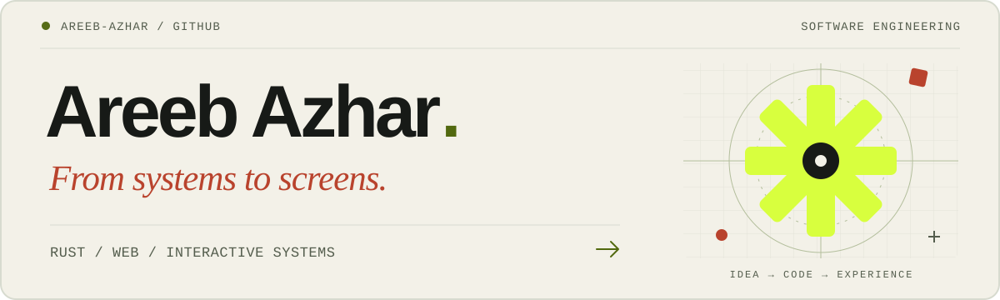
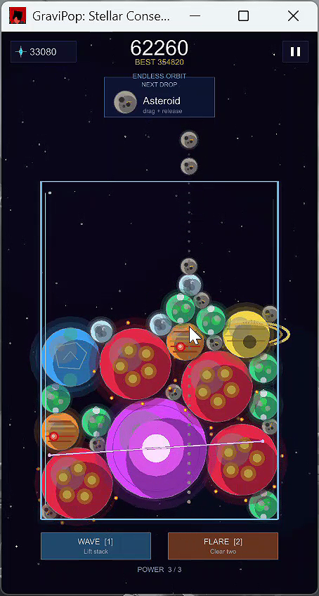
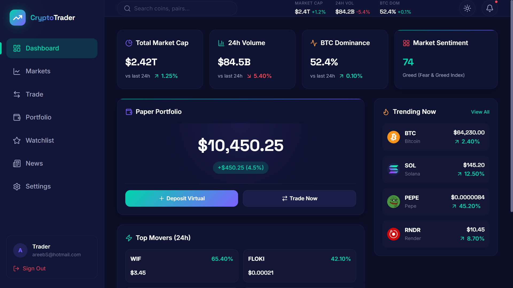

<a href="https://areeb-azhar.github.io/Portfolio/">
  <picture>
    <source media="(prefers-color-scheme: dark)" srcset="./assets/profile-header.svg" />
    <source media="(prefers-color-scheme: light)" srcset="./assets/profile-header-light.svg" />
    
  </picture>
</a>

<p align="center">
  <a href="https://areeb-azhar.github.io/Portfolio/"><strong>Explore my portfolio ↗</strong></a>
  &nbsp; · &nbsp;
  <a href="#selected-work">Selected work</a>
  &nbsp; · &nbsp;
  <a href="mailto:areebazhar3@gmail.com">Get in touch</a>
</p>

# Hi, I'm Areeb.

**BS Software Engineering student in Karachi, Pakistan.** I build Rust applications, web products, and interactive experiences. I enjoy connecting the pieces: backend logic, useful APIs, and an interface that makes the result easy to use.

My work ranges from a chatbot you can teach to a physics-driven merge puzzle and a blockchain credential prototype. I care about readable code, clear technical decisions, and testing what I build.

> **Recent milestone** · Completed a nine-week internship in **Blockchain Technology & Rust Programming**, jointly delivered by Hazara University, Mansehra, and Rockstable. September 2026 · [Completion certificate ↗](https://areeb-azhar.github.io/Portfolio/certificates/rust-internship-areeb-azhar.pdf)

## Selected work

Four projects across systems, games, blockchain, and the web. Each repository has its own source and setup guide.

### 01 / [RustBot](https://github.com/AREEB-AZHAR/RustBot)

**A local chatbot with a Rust core and a browser interface.** Chat with its knowledge base, teach it new answers, and manage what it remembers. The Rust server handles matching, persistence, and APIs; the browser handles the conversation and knowledge tools.

`Rust` `HTTP APIs` `JavaScript` `HTML / CSS`

[Explore the code →](https://github.com/AREEB-AZHAR/RustBot#readme)

### 02 / [GraviPop](https://github.com/AREEB-AZHAR/gravipop-mobile)

**A cosmic merge puzzle built in Rust.** Drop and combine celestial bodies in a physics-driven game designed for web, Android, and desktop. This project brings together game logic, collision handling, input, audio, and a shared leaderboard.

`Rust` `Macroquad` `WebAssembly` `Android`

[Explore the code →](https://github.com/AREEB-AZHAR/gravipop-mobile#readme)

<details>
  <summary>See GraviPop gameplay</summary>
  <br />
  <p align="center">
    
  </p>
  <p align="center"><sub>Actual gameplay screenshot, also featured in my portfolio.</sub></p>
</details>

### 03 / [Degree Verification](https://github.com/AREEB-AZHAR/Degree-blockchain)

**A prototype for issuing and verifying academic credentials.** Separate registrar, student, and public verification portals connect to a Hyperledger Fabric network through an Express gateway. A companion sandbox explores Merkle proofs and privacy concepts through simulations.

`Hyperledger Fabric` `Express` `CouchDB` `Docker`

[Explore the code →](https://github.com/AREEB-AZHAR/Degree-blockchain#readme)

### 04 / [CryptoTrader](https://github.com/AREEB-AZHAR/CryptoDashboard)

**A market dashboard and paper-trading simulator.** Explore cryptocurrency data, interactive charts, and watchlists, then practise trades with virtual funds. Portfolio and watchlist state persist locally in the browser.

`React` `Vite` `TanStack Query` `Zustand` `CoinGecko`

[Explore the code →](https://github.com/AREEB-AZHAR/CryptoDashboard#readme)

<details>
  <summary>See the CryptoTrader dashboard</summary>
  <br />
  
  <p><sub>Actual application screenshot. The portfolio shown uses simulated funds.</sub></p>
</details>

**Also exploring:** [Tally, a Flutter finance ledger](https://github.com/AREEB-AZHAR/flutter_calculator_new) · [Bunetto, an ecommerce storefront](https://github.com/AREEB-AZHAR/Bunetto) · [More projects and case studies ↗](https://areeb-azhar.github.io/Portfolio/#work)

## Toolkit

Technologies I've used across personal projects, coursework, and internship work.

### Languages

<picture>
  <source media="(prefers-color-scheme: dark)" srcset="./assets/icons/languages-dark.svg" />
  
</picture>

### Web, mobile & games

<picture>
  <source media="(prefers-color-scheme: dark)" srcset="./assets/icons/frameworks-dark.svg" />
  
</picture>

### Data & delivery

<picture>
  <source media="(prefers-color-scheme: dark)" srcset="./assets/icons/platforms-dark.svg" />
  
</picture>

<details>
<summary>Full toolkit, including blockchain and game frameworks</summary>

| Area | Tools I work with |
| :--- | :--- |
| **Systems & backend** | Rust, Node.js, Express, HTTP / JSON APIs |
| **Web interfaces** | React, JavaScript, TypeScript, Vite, HTML, CSS |
| **Mobile & games** | Flutter, Dart, Macroquad, Unity, C# |
| **Data & blockchain** | SQLite, Firebase, CouchDB, Hyperledger Fabric, Docker |
| **Algorithms & tooling** | Python, Java, Git, GitHub, Shopify / Liquid |

</details>

## GitHub activity

<p align="center">
  <a href="https://github.com/AREEB-AZHAR?tab=repositories">
    <picture>
      <source media="(prefers-color-scheme: dark)" srcset="./assets/generated/stats-dark.svg" />
      
    </picture>
  </a>
  <a href="https://github.com/AREEB-AZHAR?tab=repositories">
    <picture>
      <source media="(prefers-color-scheme: dark)" srcset="./assets/generated/languages-dark.svg" />
      
    </picture>
  </a>
</p>

<p align="center"><sub>Snapshots of public GitHub activity. Language percentages reflect repository code size.</sub></p>

### A year of contributions, in motion

<picture>
  <source media="(prefers-color-scheme: dark)" srcset="./assets/generated/contributions-dark.svg" />
  
</picture>

[View the contribution calendar →](https://github.com/AREEB-AZHAR#year-list-container)

## How I build

- **Understand the whole flow.** Start with the problem and trace it from data to interface.
- **Make the decisions readable.** Keep the code, architecture, and documentation easy to follow.
- **Check the result.** Test the behaviour, listen to feedback, and be clear about a prototype's limits.

## Let's connect

I'm interested in software engineering opportunities where I can contribute, keep learning, and take a problem from idea to working software.

**[Portfolio ↗](https://areeb-azhar.github.io/Portfolio/)** &nbsp; · &nbsp; **[Email me ↗](mailto:areebazhar3@gmail.com)** &nbsp; · &nbsp; **[Browse all repositories ↗](https://github.com/AREEB-AZHAR?tab=repositories)**

---

<details>
<summary>About this profile · local preview, structure, and maintenance</summary>

### What this repository does

This is the source for my [GitHub profile README](https://github.com/AREEB-AZHAR). GitHub displays the root `README.md` because this public repository has the same name as my account. The [portfolio website](https://github.com/AREEB-AZHAR/Portfolio) is a separate project.

### Latest update · 23 October 2026

- Added themed tool-icon groups, GitHub activity and language cards, and a contribution snake generated from my own GitHub calendar.
- Added daily GitHub Actions updates with read-only generators and a separate job that validates and publishes the six generated SVGs.
- Added coordinated light and dark SVG banners inspired by the portfolio's visual identity.
- Brought RustBot and GraviPop into the selected work, alongside degree verification and CryptoTrader.
- Added the internship milestone, direct contact links, and genuine project screenshots.
- Simplified the profile into a single reading column and kept maintenance instructions in this expandable section.

### Clone and preview locally

1. Install [Git](https://git-scm.com/downloads) and [Visual Studio Code](https://code.visualstudio.com/). Any editor with Markdown preview will also work. On Windows, reopen PowerShell after installing Git so the `git` command is available.
2. Open a terminal and clone this repository:

   ```sh
   git clone https://github.com/AREEB-AZHAR/AREEB-AZHAR.git
   cd AREEB-AZHAR
   ```

3. Open the folder in your editor. In VS Code, use **File → Open Folder**, select `AREEB-AZHAR`, and open `README.md`.
4. Open Markdown preview with **Ctrl+Shift+V** on Windows/Linux or **Cmd+Shift+V** on macOS. Use the preview button in the editor if your shortcuts differ. Editor previews can differ from GitHub, especially for theme-aware images.
5. Open both files under `assets/` ending in `.svg` in a browser to inspect the light and dark banners directly. Expand the project screenshot sections in Markdown preview.

**Local dependencies and configuration:** viewing and editing the profile requires only Markdown and static images. There are no local packages to install, no build or application server, and no local environment variables, secrets, Node.js, Rust, JDK, or platform SDK requirement. The optional visual-generation workflow runs on GitHub-hosted Ubuntu and installs its own Node.js dependencies. Project-specific setup instructions live in the linked project repositories.

### File structure and rendering

```text
AREEB-AZHAR/
├── .github/workflows/profile-assets.yml # Daily visual generation and publishing
├── README.md                         # Profile content and this maintenance guide
└── assets/
    ├── profile-header.svg            # Dark-theme banner
    ├── profile-header-light.svg      # Light-theme banner and fallback
    ├── icons/                        # Themed Skill Icons and their MIT license
    ├── generated/                    # Stats, languages, and contribution SVGs
    └── screenshots/
        ├── gravipop-gameplay.png     # Actual gameplay capture
        └── crypto-dashboard.png     # Actual dashboard capture
```

GitHub renders the Markdown and supported HTML. The `<picture>` element selects a banner for the viewer's color scheme; the `` provides a light-theme fallback. Both SVGs are self-contained, use system font fallbacks, and require no scripts, remote fonts, or image-generation service. Essential profile and project information remains available as text.

The screenshots come from this account's [portfolio image assets](https://github.com/AREEB-AZHAR/Portfolio/tree/main/public/projects), copied here so they do not depend on the portfolio deployment. They show the captured versions of the projects; they are not live feeds.

### Stats, contribution animation, and icons

The cards are generated with [GitHub Readme Stats Action](https://github.com/stats-organization/github-readme-stats-action), and the snake with [Platane/snk](https://github.com/Platane/snk). The palette matches the profile banner in both themes. The cards show public activity, with commit and contribution counts covering the period labeled on the card; the language card describes code size in eligible public repositories. Snapshots refresh through the workflow below.

Tool icons are bundled from [Skill Icons](https://github.com/tandpfun/skill-icons) under its [MIT license](./assets/icons/LICENSE.txt). Each sheet has a light and dark version, and descriptive alternative text names the tools. The full text toolkit remains available above. To change the icons, use the upstream SVGs, preserve their license, and update both theme variants and the alternative text.

The profile displays repository-hosted assets, so visitors do not need a third-party stats or icon server to render them. To refresh the stats and animation:

1. The workflow runs daily at **01:17 UTC / 06:17 Pakistan time**, subject to GitHub scheduling delays. To refresh sooner, open **Actions → Refresh profile visuals → Run workflow** in this repository. You need write access to start a manual run.
2. The **generate** job runs pinned third-party generators with **read-only repository access**. It uploads a **profile-visuals** artifact containing exactly six SVGs: `stats-dark.svg`, `stats-light.svg`, `languages-dark.svg`, `languages-light.svg`, `contributions-dark.svg`, and `contributions-light.svg`.
3. A separate **publish** job uses GitHub's checkout and artifact-download actions, checks the expected filenames and SVG contents without executing them, and commits only `assets/generated/*.svg` to `main`. This is the only job with `contents: write` permission. Generation or validation failure leaves the previously published images in place.
4. The workflow uses the automatic `GITHUB_TOKEN`; no personal access token or extra repository secret is required. If repository rules prevent bot pushes to `main`, the publish job will fail. Keep the existing snapshots and either publish the artifact manually or adapt the process to your branch rules.
5. To publish manually, download the successful run's **profile-visuals** artifact, extract its six files into `assets/generated/`, preview them, and use the commit/push instructions below.

Scheduled workflows in public repositories can be disabled by GitHub after 60 days without repository activity; re-enable them from the Actions page when needed. Icon sheets are static and only change when deliberately edited.

### Editing and publishing

1. Edit the introduction, selected work, or toolkit in `README.md`. Keep the featured list focused, and confirm descriptions against each project's source and README. Label prototypes and simulations accurately.
2. When changing the banner, update both SVG variants. Keep meaningful alternative text and avoid making the image the only place a fact appears.
3. When refreshing screenshots, capture the actual application, remove any private data, replace the corresponding image, and check its caption and alternative text.
4. Preview the result. Check narrow and wide layouts, both color themes, expandable screenshots, and all destination links. GitHub's rendered view is the final check.
5. Review and commit only the files you intended to change:

   ```sh
   git status --short
   git diff --check
   git diff -- README.md assets/
   git add README.md assets/
   git commit -m "Refresh profile content and artwork"
   git push origin main
   ```

   Pushing requires write access and GitHub authentication, for example through Git Credential Manager. Contributors without write access should fork the repository and submit a pull request. If working on a separate branch, push that branch and merge it into `main` before expecting the public profile to change.

6. Open [the public profile](https://github.com/AREEB-AZHAR) after the push and confirm that the new content and images appear. A successful push alone does not confirm the rendered result.

### Formatting references

- [GitHub: managing your profile README](https://docs.github.com/en/account-and-profile/how-tos/profile-customization/managing-your-profile-readme)
- [GitHub: theme-aware pictures and Markdown formatting](https://docs.github.com/en/get-started/writing-on-github/getting-started-with-writing-and-formatting-on-github/quickstart-for-writing-on-github)
- [GitHub: scheduled workflow behavior](https://docs.github.com/en/actions/reference/workflows-and-actions/events-that-trigger-workflows#schedule)

</details>
