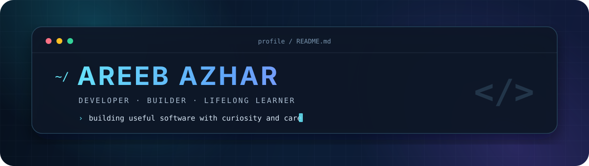

  

<h1 align="center">Hi, I'm Areeb Azhar</h1>

  <strong>Software developer building practical web products, interactive tools, and Unity experiences.</strong>

  <a href="https://areeb-azhar.github.io/Portfolio/">Portfolio</a>
  ·
  <a href="https://github.com/AREEB-AZHAR?tab=repositories">Projects</a>
  ·
  <a href="https://github.com/AREEB-AZHAR">GitHub</a>

## About

I'm a Software Engineering student who enjoys taking ideas from rough concepts to working products. My recent work spans React applications, blockchain-backed credential verification, and interactive Unity prototypes.

I care about clear interfaces, practical architecture, readable code, and learning by building.

> **Current focus:** creating useful software across the web, blockchain, and interactive systems—then documenting it well enough for others to understand.

## Selected work

### [On-Chain Credential Attestation](https://github.com/AREEB-AZHAR/Degree-blockchain)

A degree issuance and verification prototype built around Hyperledger Fabric, an Express gateway, and a privacy-preserving proof sandbox.

`Hyperledger Fabric` `Express` `TypeScript` `JavaScript` `Docker`

### [CryptoTrader](https://github.com/AREEB-AZHAR/CryptoDashboard)

A real-time cryptocurrency dashboard and paper-trading simulator with market data, interactive charts, watchlists, and local portfolio tracking.

`React 19` `Vite` `TanStack Query` `Zustand` `CoinGecko API`

### [Unity Minigame Suite](https://github.com/AREEB-AZHAR/fyp-project-2026-05-24_04-55-34)

A collection of card-matching, color-path, and connect-the-dots minigames, supported by custom shaders and Python-generated assets.

`C#` `Unity` `ShaderLab` `HLSL` `Python`

  <a href="https://areeb-azhar.github.io/Portfolio/"><strong>View the complete portfolio →</strong></a>

## Toolkit

| Area | Technologies |
| --- | --- |
| **Languages** | JavaScript, TypeScript, Python, C#, Java, Dart |
| **Web & APIs** | React, Node.js, Express, Vite, HTML5, CSS3 |
| **Systems & platforms** | Hyperledger Fabric, Docker, CouchDB, Unity, Flutter, Shopify / Liquid |

## How I approach the work

<table>
  <tr>
    <td width="33%" valign="top">
      <h3>01 · Understand</h3>
      Start with the problem, the people using the solution, and the constraints that matter.
    </td>
    <td width="33%" valign="top">
      <h3>02 · Build</h3>
      Prefer simple architecture, readable code, and small decisions that are easy to explain.
    </td>
    <td width="33%" valign="top">
      <h3>03 · Improve</h3>
      Test assumptions, learn from feedback, and leave every project stronger than it started.
    </td>
  </tr>
</table>

## Explore more

The portfolio contains case studies across full-stack development, blockchain, game development, mobile applications, and ecommerce.

  <a href="https://github.com/AREEB-AZHAR?tab=repositories"><strong>Browse all repositories →</strong></a>

---

  Good software is not only written—it is understood, tested, and continuously improved.

<!--
Maintenance note: keep "Selected work" limited to the strongest 2–4 projects.
For each one, describe the problem, your contribution, and one concrete result.
-->
